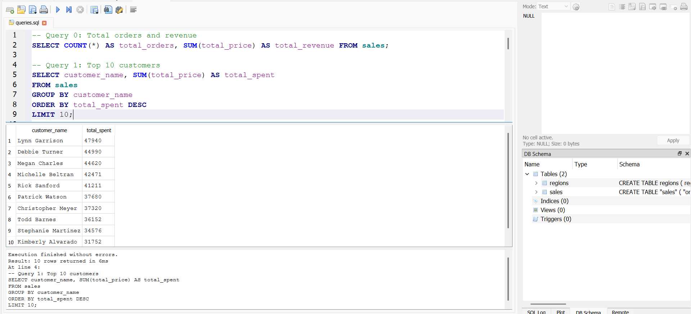
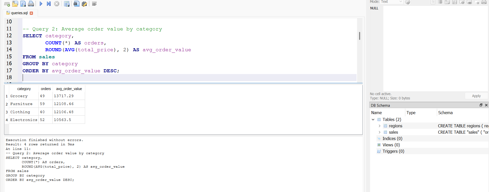

# SQL Sales Analysis

SQL queries to analyse sales data and find top customers and average order values. This is my Week 2 project for the Data Analyst Course (SQL for Data Analysis).

## Dataset

- File: `SQL_Sales_Dataset_200_Rows_xlsx_-_Sheet1.csv`
- 200 orders from 24 Dec 2024 to 24 Jun 2025, with no missing values or duplicates
- Columns: order_id, customer_name, order_date, category, sub_category, product_name, quantity, unit_price, total_price, region
- Note: each customer appears only once, so "top customers" means the customers with the biggest single orders

## Files

- `queries.sql`: all the SQL queries
- `sales.db.db`: SQLite database (table `sales` and table `regions`)
- `top_customers.png`: result of the top customers query
- `avg_order_value.png`: result of the average order value query

## Tools Used

- DB Browser for SQLite

## Queries and Concepts Covered

| Query | What it does | Concepts used |
|---|---|---|
| 0 | Total orders and total revenue | SELECT, COUNT, SUM |
| 1 | Top 10 customers by total spent | GROUP BY, ORDER BY, LIMIT |
| 2 | Average order value for each category | AVG, ROUND, GROUP BY |
| 3 | Orders above the overall average | WHERE with a subquery |
| 4 | Orders labelled High, Medium or Low | CASE statement |
| 5 | Revenue and average order value by region | JOIN with a `regions` table |

## Results

### Top Customers

### Average Order Value by Category

## Key Insights

- There are 200 orders with a total revenue of 2,420,107, and the average order value is about 12,100.54
- Lynn Garrison is the top customer with 47,940, followed by Debbie Turner (44,990) and Megan Charles (44,620)
- Grocery has the highest average order value (about 13,717.29) and Electronics the lowest (about 10,563.50)
- 81 orders are above the overall average order value
- Order levels: 48 High (20,000 or more), 39 Medium (10,000 to 19,999) and 113 Low (below 10,000)
- South brings in the most revenue (808,651), while West has the highest average order value (about 13,938.77)

## How to Run

1. Open `sales.db.db` in DB Browser for SQLite
2. Go to the Execute SQL tab
3. Paste a query from `queries.sql` and run it
